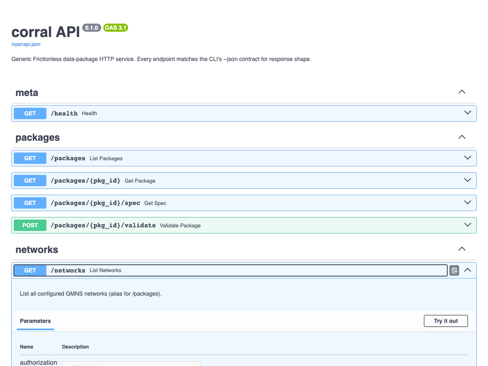

# Self-host the HTTP server

## When to use this

You want HTTP access to your GMNS networks — for dashboards, non-Python consumers, or a small team sharing a single curated set of packages. The server is read-only: it serves metadata, the resolved spec, validation reports and quality reports, never edits.

## Quick example

Write a minimal config that binds localhost on port 8000, requires a bearer token, and exposes one package. Start it with `netstead server run`:

```yaml
# server.yaml
bind: 127.0.0.1
port: 8000
auth:
  kind: bearer
  token: "paste-the-output-of-generate_dev_token-here"
packages:
  - id: leavenworth
    source: packages/netstead/netstead/fixtures/leavenworth/csv
```

```bash
netstead server run --config server.yaml
```

Expected:

```text
INFO:     Uvicorn running on http://127.0.0.1:8000
```

{ .screenshot }
*Interactive OpenAPI at `/docs` — every endpoint with try-it-out forms and the JSON response schema.*

## Step-by-step

### 1. Install the `[server]` extra

`[server]` brings in FastAPI, uvicorn and pydantic-settings. Add `[graph]` as well if you want `/networks/{id}/quality` — the GMNS rule pack's connectivity rule needs scipy:

```bash
pip install 'netstead[server,graph]'
```

### 2. Generate a dev token

`generate_dev_token()` returns one URL-safe random string (`secrets.token_urlsafe(32)`). The same string goes into the config and into every client's `Authorization` header — the server stores it as given, it does not hash it:

```bash
python -c "from corral.api import generate_dev_token; print(generate_dev_token())"
```

Expected (yours will differ):

```text
D--IvW8W34gDhwRQC2D9ro9mhSEfPXsPX8XnBV8UUaU
```

Paste it into `auth.token` in your config and keep it with the same care as any other shared secret.

### 3. Write a config YAML

A config is one `ServerSettings` document (`corral.api.config`): `bind`, `port`, an `auth` block and a `packages` list. Each package has a URL-safe `id`, a `source` that `Network.from_source` accepts, and an optional `description` echoed by `/networks`. There are no per-package engine or spec-version keys and no logging section — the spec version is detected from the data, and logging is uvicorn's:

```yaml
# server.yaml
bind: 127.0.0.1      # 0.0.0.0 to accept off-host requests (see pitfalls)
port: 8000

auth:
  kind: bearer       # or "none" — see pitfalls
  token: "paste-the-output-of-generate_dev_token-here"

packages:
  - id: leavenworth
    source: packages/netstead/netstead/fixtures/leavenworth/csv
    description: Bundled Leavenworth, WA fixture (GMNS 0.97)
  - id: regional
    source: s3://my-bucket/regional/datapackage.json
```

JSON works too (`--config server.json`). YAML parsing uses `pyyaml`, which `uvicorn[standard]` (part of the `[server]` extra) already installs.

### 4. Run it + verify

Start the server, then hit `/health` (the unauthenticated liveness probe) to confirm it's up. `--bind` / `--port` override the config for a one-off run:

```bash
netstead server run --config server.yaml
```

```bash
curl http://127.0.0.1:8000/health
```

Expected:

```json
{"status": "ok"}
```

### 5. Make authenticated requests

Pass the token from step 2 as a bearer header. Every response is JSON, whatever `Accept` header the client sends. `/networks` is the cheap listing — it echoes the config without loading anything:

```bash
TOKEN="paste-the-output-of-generate_dev_token-here"
curl -H "Authorization: Bearer $TOKEN" http://127.0.0.1:8000/networks
```

Expected:

```json
[{"id": "leavenworth", "source": "packages/netstead/netstead/fixtures/leavenworth/csv", "description": "Bundled Leavenworth, WA fixture (GMNS 0.97)"}]
```

Counts and the spec version are on the per-network endpoint, which loads the package on first access:

```bash
curl -H "Authorization: Bearer $TOKEN" http://127.0.0.1:8000/networks/leavenworth
```

Expected:

```json
{"id": "leavenworth", "name": "gmns", "spec_version": "0.97", "engine": "IbisEngine", "links": 339, "nodes": 121, "table_count": 9, "tables": ["geometry", "lane", "link", "link_tod", "node", "signal_controller", "time_set_definitions", "use_definition", "use_group"]}
```

Quality checks are a `POST` (a `GET` returns `405 Method Not Allowed`). The body is the same `ValidationReport.to_dict()` shape the CLI's `--json` emits:

```bash
curl -X POST -H "Authorization: Bearer $TOKEN" \
     http://127.0.0.1:8000/networks/leavenworth/quality
```

### 6. Endpoint list

| Endpoint | Returns |
|---|---|
| `GET /health` | `{"status": "ok"}` (no auth) |
| `GET /packages` | `[{id, source, description}]` — configured packages, nothing loaded |
| `GET /packages/{id}` | `{id, name, engine, table_count, tables: [{name, rows, columns}]}` |
| `GET /packages/{id}/spec` | resolved Frictionless `datapackage.json` |
| `POST /packages/{id}/validate` | full validation report (`ValidationReport.to_dict()`); packages are loaded as `Network`s, so this is GMNS validation with `spec_version` set |
| `GET /networks` | same listing as `/packages` |
| `GET /networks/{id}` | `{id, name, spec_version, engine, links, nodes, table_count, tables}` |
| `POST /networks/{id}/quality` | the GMNS rule pack as a validation report (needs `[graph]`) |

Interactive OpenAPI at `http://127.0.0.1:8000/docs`.

## Common variations

???+ note "Default — localhost bind with bearer auth"
    Safe default for dev and single-host production behind a reverse proxy.

    ```yaml
    bind: 127.0.0.1
    auth: { kind: bearer, token: "..." }
    ```

??? note "Off-host access (LAN, etc.)"
    Bind `0.0.0.0` — but keep auth on.

    ```yaml
    bind: 0.0.0.0
    auth: { kind: bearer, token: "..." }
    ```

??? note "Behind nginx / Caddy"
    Bind to `127.0.0.1`; let the proxy terminate TLS and forward. No server-side TLS config needed.

    ```yaml
    bind: 127.0.0.1
    port: 8000
    ```

??? note "One token per client"
    The config holds exactly one `auth.token`. To give each client its own credential, run one server process (and config) per client, or put an authenticating reverse proxy in front and let it hold the per-client secrets.

??? note "Disable auth (dev only)"
    The server still starts on a public bind with `kind: none` — it only logs a warning (see pitfalls) — so pair this with a localhost bind.

    ```yaml
    bind: 127.0.0.1
    auth: { kind: none }
    ```

??? note "Docker"
    The repo ships a server image definition at `packages/netstead/Dockerfile` (plus `docker-compose.example.yml` beside it). Build it from the repo root — the build needs both workspace packages — and mount your config and data:

    ```bash
    docker build -f packages/netstead/Dockerfile -t netstead-server .
    docker run --rm -p 8000:8000 \
        -v $(pwd)/server.yaml:/etc/netstead/config.yml:ro \
        -v $(pwd)/data:/data:ro \
        netstead-server
    ```

    A prebuilt `ghcr.io` image is not published yet (tracked in [#104](https://github.com/e-lo/netstead/issues/104)). Alternatively, `pip install` into your own image and copy the config alongside:

    ```dockerfile
    FROM python:3.12-slim
    RUN pip install 'netstead[server,graph]'
    COPY server.yaml /etc/netstead/server.yaml
    CMD ["netstead", "server", "run", "--config", "/etc/netstead/server.yaml"]
    ```

## Pitfalls

* **`auth.kind: none` + non-localhost bind is a security footgun.** The server logs a `corral.api: auth.kind='none' with bind='0.0.0.0' exposes the server with NO authentication` warning at startup and then runs anyway — there is no refuse-to-start guard and no override key. Treat the warning as a stop sign.
* **Bearer mode needs a token.** `kind: bearer` without `auth.token` fails at app build time (`AuthSettings(kind='bearer') requires token to be set`), so a misconfigured server never silently lets requests through.
* **Tokens are compared in constant time, as plaintext.** The server holds the token string from the config and checks the incoming `Authorization: Bearer …` header against it with `hmac.compare_digest`. There is no hashing — protect the config file as you would the token itself.
* **Packages are cached after first load.** The `PackageRegistry` loads each package through `Network.from_source` the first time its id is requested and keeps it for the life of the process. Edit the files on disk, or the config, and you need to restart the server to see the change.
* **No write endpoints.** The HTTP server is read-only by design. For editing, use the Python API + `Session`, or the Workbench.

## See also

* [Wire the MCP server to Claude Code / Claude Desktop](serve-mcp.md) — same data, stdio transport.
* [MCP tools reference](../ai/mcp-tools.md) — what the MCP surface exposes.
* [corral API reference](https://e-lo.github.io/netstead/corral/reference/api/) — `corral.api.ServerSettings`, `AuthSettings`, `PackageRef`, `generate_dev_token`, `load_settings`.
