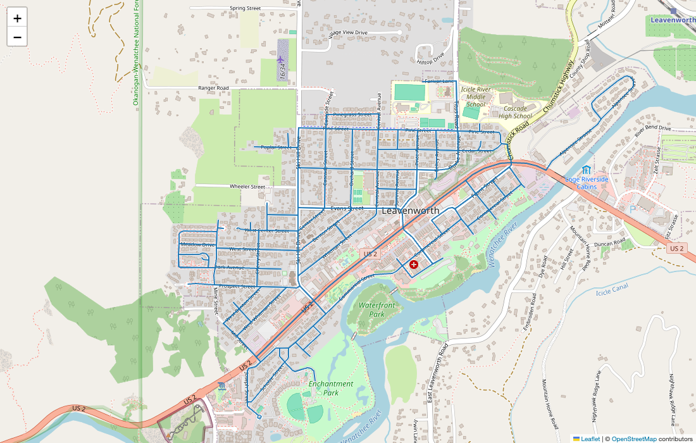
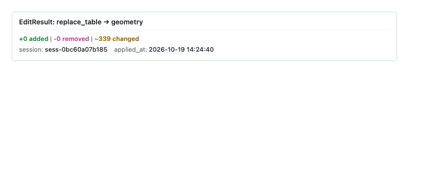

# Python tour (notebook)

## What you'll build

You'll work through the bundled Leavenworth, WA network in one notebook session and produce, in order:

1. A folium / matplotlib map of the full network.
2. A validation report rendered as an HTML card.
3. A data-quality report grouped by severity.
4. A simplify-geometry edit, rendered as a before/after diff (then rolled back).
5. A scoped subgraph around a single node, rendered side-by-side with the original.

Total runtime: under two minutes on a laptop. The fixture ships inside the `netstead` wheel (the CSV flavour is about 140 KB).

## Prerequisites

The `[clean]` extra brings in `shapely` + `geopandas` + `pyproj` for the geometry edit; `[graph]` brings in `scipy` for the scope step and the data-quality rule pack; `[notebook]` is reserved for future widgets — the `_repr_html_` cards used below render without it.

```bash
pip install 'netstead[clean,graph,notebook]'
```

For the map steps, either `folium` (interactive Leaflet) or `matplotlib` (static fallback) works — pick one:

```bash
pip install folium       # interactive Leaflet map
pip install matplotlib   # static fallback
```

The steps below show both paths.

## Steps

### 1. Load the fixture

Start by loading the bundled Leavenworth network. `Network.from_source` returns a lazy `Network` — no rows have been read from disk yet; `net.links` is a lazy `Table` (the underlying ibis expression is at `net.links.expr`).
<!-- doctest: skip -->

```python
from netstead import Network
from netstead.fixtures import leavenworth

net = Network.from_source(leavenworth.csv_dir())
print(f"{net.spec_version}: {net.links.count()} links, {net.nodes.count()} nodes")
```

You should see:

```text
0.97: 339 links, 121 nodes
```

In a notebook, evaluating `net` on its own renders an HTML summary card with the spec version, the 9 tables with their row counts, and a preview of the first rows.

{ .screenshot }
*Network summary card (net._repr_html_()) — spec 0.97, 9 tables, 339 links / 121 nodes, first-rows preview*

### 2. Render the network as a map

The `link` table is keyed to `geometry` by `geometry_id`; the `geometry.geometry` column carries each link's LineString as WKB bytes in memory (the CSV on disk stores WKT; netstead decodes it on load). Materialise both with `.to_pandas()`, join them, and decode the WKB with shapely before plotting.
<!-- doctest: skip -->

```python
import pandas as pd
from shapely import wkb

links = net.links.to_pandas()
geoms = net.tables["geometry"].to_pandas().set_index("geometry_id")
links = links.join(geoms[["geometry"]], on="geometry_id")
links["shape"] = links["geometry"].map(wkb.loads)
```

For an interactive Leaflet map, use folium. Compute the centroid from the node table, then add one PolyLine per link.
<!-- doctest: skip -->

```python
import folium

# Centroid of the network — average node y/x
nodes = net.nodes.to_pandas()
center = [nodes["y_coord"].mean(), nodes["x_coord"].mean()]

m = folium.Map(location=center, zoom_start=15, tiles="OpenStreetMap")
for shape in links["shape"]:
    coords = [(y, x) for x, y in shape.coords]  # folium wants (lat, lon)
    folium.PolyLine(coords, color="#1f77b4", weight=2, opacity=0.8).add_to(m)
m  # in a notebook, this renders the map inline
```

You should see the downtown Leavenworth grid — a compact, walkable core wrapped around Highway 2 / Front Street, surrounded by a few residential tertiary streets.

{ .screenshot }
*Folium map of the full Leavenworth fixture — downtown grid around Highway 2 with residential streets fanning out*

If `folium` isn't available, the static matplotlib fallback gives an equivalent view (without basemap tiles):
<!-- doctest: skip -->

```python
import matplotlib.pyplot as plt

fig, ax = plt.subplots(figsize=(8, 8))
for shape in links["shape"]:
    xs, ys = shape.xy
    ax.plot(xs, ys, color="#1f77b4", linewidth=1.0, alpha=0.8)
ax.set_aspect("equal")
ax.set_title(f"Leavenworth GMNS fixture — {len(links)} links")
plt.show()
```

Either way: a recognisable Bavarian-themed downtown core in an OSM-derived street network roughly 2 km across.

### 3. Validate and display the report

`net.validate()` runs the four-pass validator (structural / schema / FK / sync-state) and returns a `ValidationReport`. In a notebook, evaluating the report on its own renders a styled HTML card.
<!-- doctest: skip -->

```python
report = net.validate()
report  # in a notebook, the _repr_html_ renders a styled card
```

You should see a card with no ERRORs, 1 WARNING and 16 INFO findings. The WARNING is `fk.unverifiable` — `node.zone_id` can't be checked because the fixture ships no `zone` table; the INFOs are `structural.missing_optional_resource`, one per optional GMNS table the fixture doesn't include. No ERRORs, but that WARNING makes `report.is_clean` `False`.

{ .screenshot }
*Validation report card — 0 ERRORs, 1 WARNING fk.unverifiable, 16 INFO structural.missing_optional_resource across 9 tables*

In a non-notebook context, drop down to the text representation:
<!-- doctest: skip -->

```python
print(f"{report.spec_version}: {len(report.issues)} issues")
for issue in report.issues[:5]:
    print(f"  {issue.severity.value:9} {issue.code:30} {issue.message[:60]}")
```

### 4. Run quality and display

The data-quality pack flags things the spec is silent on but every real network has — disconnected components, lane-count mismatches, high speeds on residential facilities, near-duplicate nodes. Run it the same way as validation; the result has its own `_repr_html_`.
<!-- doctest: skip -->

```python
from corral.quality import run_quality

qreport = run_quality(net)
qreport  # _repr_html_ renders severity-grouped findings
```

You should see a card of WARNING findings (no ERRORs): 271 links with `facility_type=residential` carry `free_speed=40`, above the default 35 mph threshold of `quality.high_speed_residential` — useful for seeing what a real finding looks like, with its `fix_hint`.

{ .screenshot }
*Quality report card — 271 WARNING quality.high_speed_residential findings (residential links with free_speed=40, default 35 mph threshold)*

To see the top findings in detail, iterate over `qreport.issues`:
<!-- doctest: skip -->

```python
for issue in qreport.issues[:3]:
    print(f"  {issue.severity.value:9} {issue.code:35} {issue.message}")
```

### 5. Simplify geometry and render before/after

The `simplify_geometry` op in `netstead.clean` removes redundant vertices from link geometries. Leavenworth keeps its shapes in the `geometry` table (keyed by `link.geometry_id`), so the op edits that table directly; no inline `link.geometry` column is needed. Wrap it in a `Session` so the edit can be rolled back atomically.
<!-- doctest: skip -->

```python
from corral.editing import Session
from netstead.clean import simplify_geometry

with Session(net) as s:
    edit = simplify_geometry(net, s, mode="redundant_only", tolerance=0.000001)
    edit  # in a notebook, _repr_html_ shows the diff card (the edit targets the geometry table)
```

You should see an `EditResult` card for the `geometry` table: the op and table, the `+added / -removed / ~changed` row counts, the session id and the timestamp. `mode="redundant_only"` drops vertices that sit on the chord through their neighbours; with `tolerance=0.0` it is loss-free, and the 0.000001-degree (about 10 cm) tolerance here also catches the near-collinear vertices OSM traces leave behind, removing about a third of Leavenworth's 2,132 vertices. `mode="douglas_peucker"` is the lossy alternative with an explicit tolerance.

{ .screenshot }
*EditResult card for the simplify-geometry edit: the op and the `geometry` table, the changed-row count, session id and timestamp.*

To visualise before-and-after on one map, keep the decoded shapes from step 2 as the "before" set, then read the edited `geometry` table as the "after" set:
<!-- doctest: skip -->

```python
links_before = links[["link_id", "shape"]].copy()
# (run the simplify edit above inside the Session)
geoms_after = net.tables["geometry"].to_pandas().set_index("geometry_id")
links_after = links.copy()
links_after["shape"] = links_after["geometry_id"].map(lambda gid: wkb.loads(geoms_after.loc[gid, "geometry"]))

m = folium.Map(location=center, zoom_start=15, tiles="OpenStreetMap")
for shape in links_before["shape"]:
    folium.PolyLine([(y, x) for x, y in shape.coords],
                    color="#888", weight=4, opacity=0.4).add_to(m)
for shape in links_after["shape"]:
    folium.PolyLine([(y, x) for x, y in shape.coords],
                    color="#d62728", weight=1.5, opacity=0.9).add_to(m)
m
```

Grey underneath = before; red on top = after. The two overlays sit almost exactly on top of each other, because the dropped vertices were within 10 cm of a straight line, so look for the red line cutting the tiny kinks on the curved tertiary links.

To restore the original state, roll the session back:
<!-- doctest: skip -->

```python
s.rollback()
```

The session's chronological log reverses the edit, so the network returns to step 1: 339 links, with every vertex back in the `geometry` table.

### 6. Build a scope from a single node and render

`from_node` builds a network-distance-bounded subgraph around a seed node. The 200 m buffer below is Dijkstra-bounded along the routable graph — links that are spatially close but only reachable via long detours fall outside.
<!-- doctest: skip -->

```python
from netstead.scope import from_node

scoped = from_node(net, node_id=1, network_buffer="200m").apply()
print(f"scoped: {scoped.links.count()} links, {scoped.nodes.count()} nodes")
```

You should see `scoped: 8 links, 5 nodes`. Every related table (`lane`, `link_tod`, `movement`, signal tables) is pre-filtered by FK chain, so the result is a self-consistent GMNS network you can write back out.

Render the scope side-by-side with the original to see the contrast — full network as grey context, scoped subgraph highlighted.
<!-- doctest: skip -->

```python
scoped_links = scoped.links.to_pandas().join(geoms[["geometry"]], on="geometry_id")
scoped_links["shape"] = scoped_links["geometry"].map(wkb.loads)

m = folium.Map(location=center, zoom_start=15, tiles="OpenStreetMap")
# Full network, faint
for shape in links["shape"]:
    folium.PolyLine([(y, x) for x, y in shape.coords],
                    color="#bbb", weight=1, opacity=0.5).add_to(m)
# Scope, highlighted
for shape in scoped_links["shape"]:
    folium.PolyLine([(y, x) for x, y in shape.coords],
                    color="#2ca02c", weight=3, opacity=0.95).add_to(m)
m
```

You should see a small green subgraph centred on one intersection, with the rest of the network greyed out as context.

{ .screenshot }
*Scoped subgraph (200 m network buffer around node 1, green) over the full Leavenworth network (grey)*

## Variations you might try

Each accordion below is a one-line tweak that shows off a different facet of the toolkit. Pick whichever matches what you want to learn next.

???+ note "Try a different fixture or your own network"
    The bundled fixture is Leavenworth. Point `Network.from_source` at any GMNS package on disk or in cloud storage to repeat the tour with your own data — every step above is fixture-agnostic.
<!-- doctest: skip -->

    ```python
    net = Network.from_source("./my-network/")
    net = Network.from_source("s3://my-bucket/network.parquet/")
    ```

??? note "Configure a custom quality threshold"
    Override the `quality.high_speed_residential` threshold (default is conservative). Tightening it surfaces more findings on a network with mixed posted speeds.
<!-- doctest: skip -->

    ```python
    from corral.quality import RuleConfig, run_quality

    qreport = run_quality(
        net,
        config={
            "quality.high_speed_residential": RuleConfig(
                thresholds={"speed_limit_mph": 30.0}
            )
        },
    )
    ```

## Next steps

* [Cookbook](cookbook/index.md) — task-oriented recipes for any of the workflows above.
* [API reference](reference/api.md) — every symbol you used in this tour.
* [Architecture](https://e-lo.github.io/netstead/corral/architecture/) — design rationale for sessions, scopes, and the lazy-by-default engine.
* [Table of tables](reference/table-of-tables.md) — what other GMNS tables you can pull from `net.tables[...]`.
