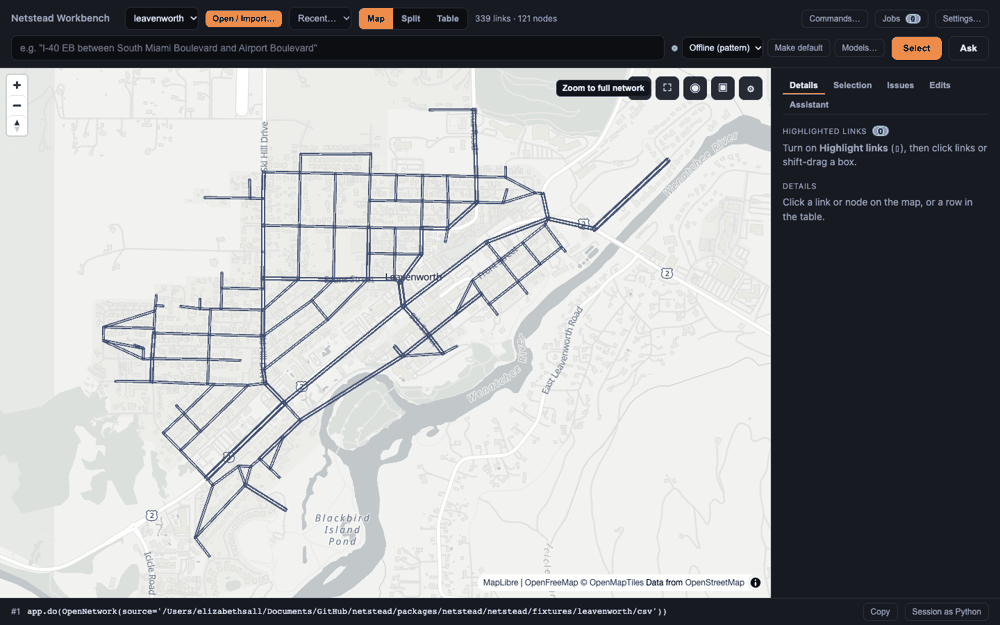
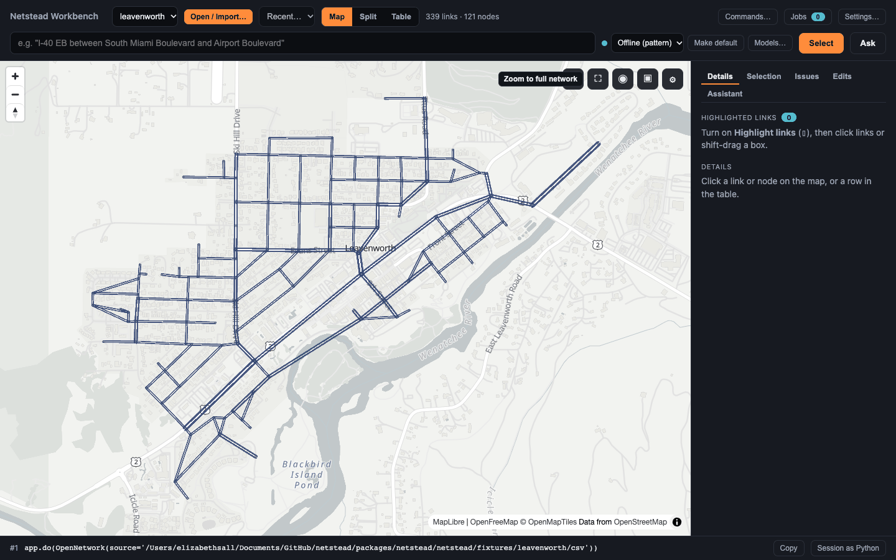
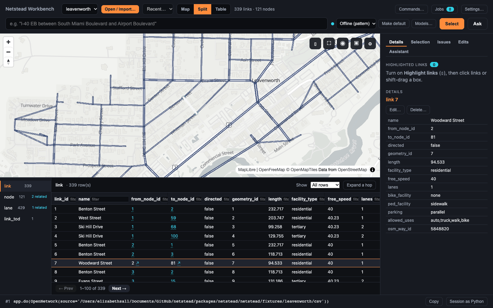
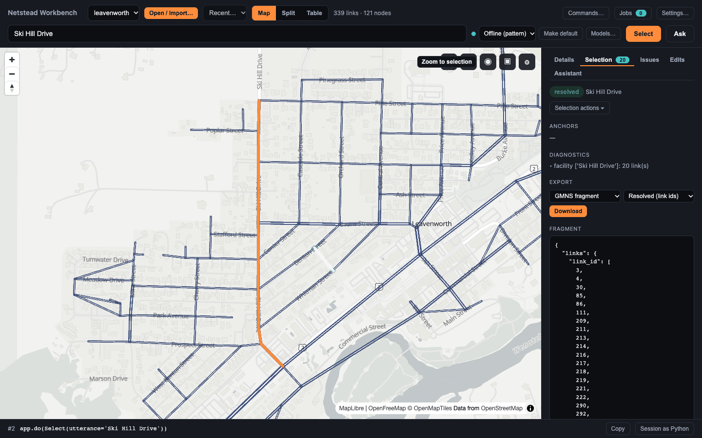
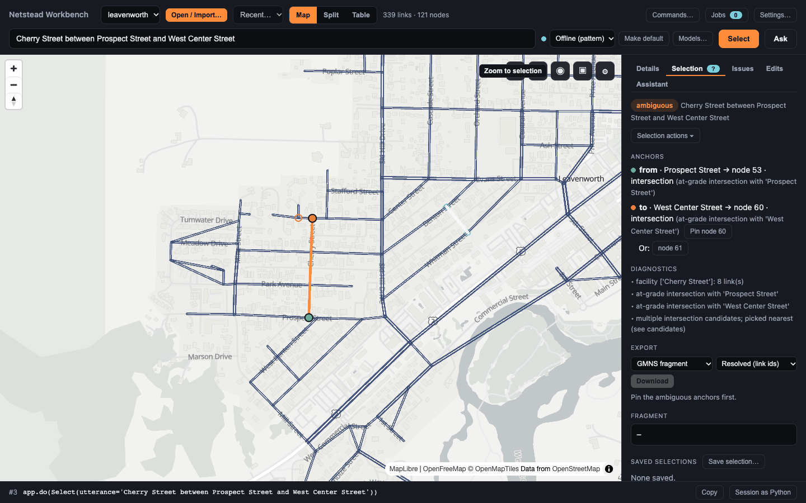
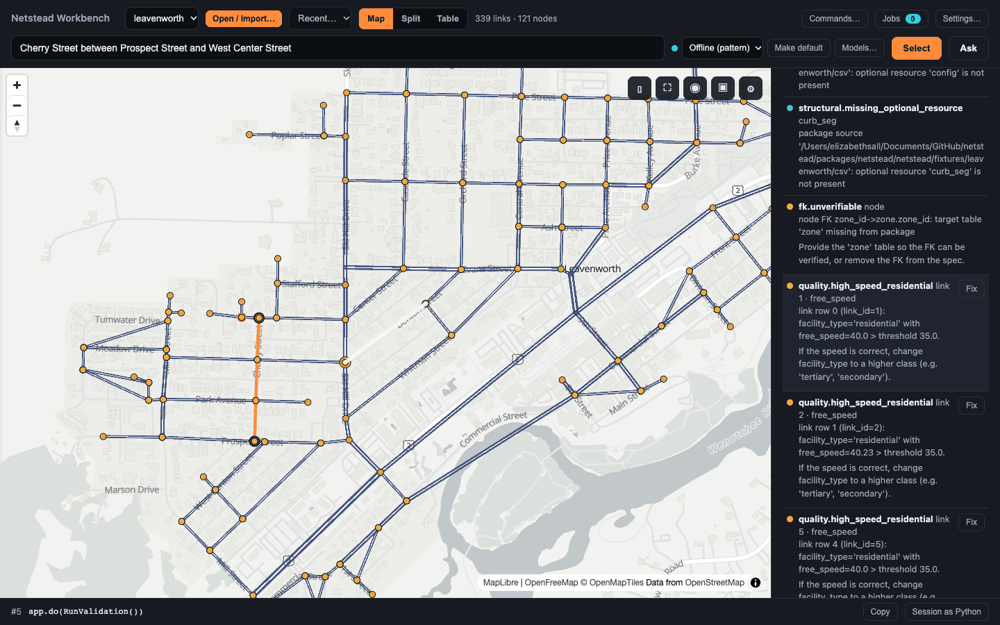
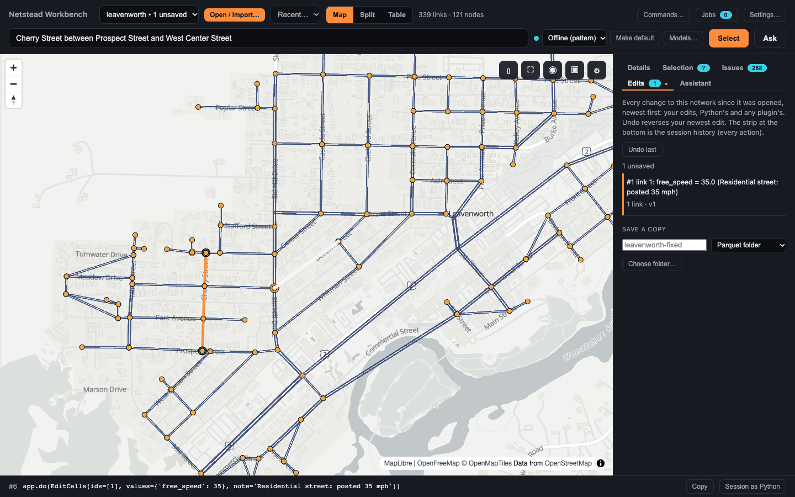
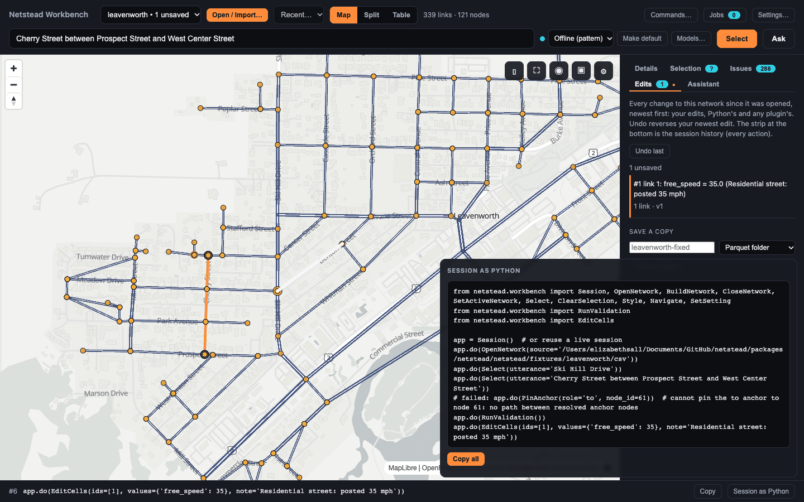
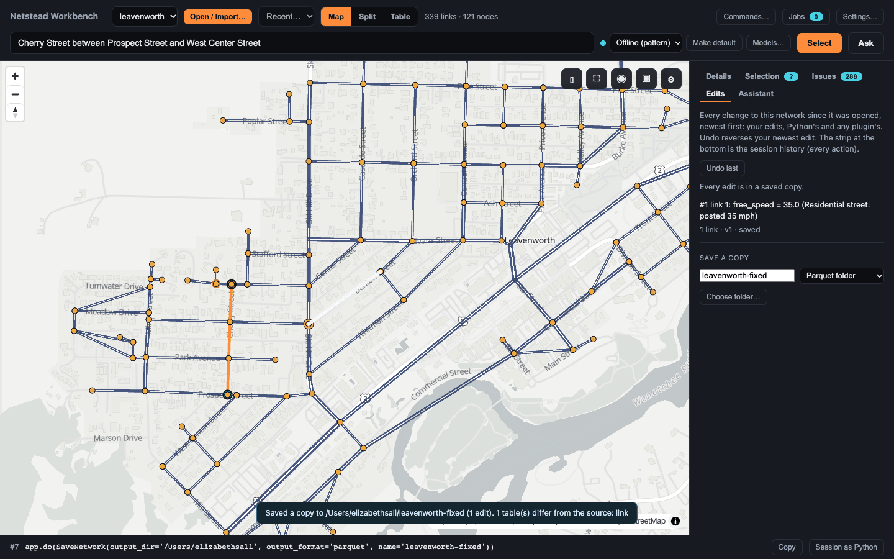

<!-- screenshots: refresh after the beta-feedback PR merges -->

# Quickstart: the Workbench

Prefer code? → [Quickstart: Python](quickstart.md) does the same work from a Python session.

## What you'll build

{ .screenshot }
*The whole tutorial in a minute: open, select, validate, fix, replay. (screenshot predates the panel restructure)*

In ten minutes, with nothing but a browser, you will:

1. Open the bundled Leavenworth, WA network (339 links, 121 nodes) in the Workbench.
2. Pick a link on the map and see its row in the table, and the other way round.
3. Select a street by name, then resolve a selection the resolver found **ambiguous**.
4. Validate the network against the GMNS spec and the quality rules.
5. Fix a finding, see the edit tracked, and undo it.
6. See every step as a Python script you can run again.
7. Save the edited network as a copy, with the original untouched.

Everything runs on your machine. With `--provider stub` the selection box uses an offline pattern parser, so
nothing leaves your computer and you need no API key.

## Prerequisites

Python 3.11 or newer, and `netstead` with four extras: `[server]` is the Workbench itself, `[graph]` runs the
quality rules inside validation and the path search behind "between", `[nl]` adds the language-model
providers you can switch to later (the offline parser needs none of them), and `[osm]` powers Open → Place search
and building a network from OpenStreetMap. If anything below fails to
install or start, see [Install and troubleshoot](install.md).

## Steps

### 1. Install and open the network

Install with the tool you already use. `netstead` 1.0.0b2 is not on PyPI yet, so the beta installs from
GitHub, both packages in one command (`pip install` takes the same two arguments). The quotes matter on
macOS (zsh): see [Install and troubleshoot](install.md#zsh-quote-the-brackets).

```bash
uv init --bare
uv add \
  "dbcorral @ git+https://github.com/e-lo/netstead.git@main#subdirectory=packages/corral" \
  "netstead[server,graph,nl,osm] @ git+https://github.com/e-lo/netstead.git@main#subdirectory=packages/netstead"
```

`uv init --bare` makes a new folder a uv project, which `uv add` needs; skip it when you add netstead to a project you already have.

(Once the PyPI release is out: `uv add 'netstead[server,graph,nl,osm]'`.)

The Leavenworth fixture ships inside the `netstead` wheel, so there is nothing to download. Ask Python where
it landed and keep the path in a shell variable:

```bash
LV=$(uv run python -c "from netstead.fixtures import leavenworth; print(leavenworth.csv_dir())")
echo "$LV"
```

Start the Workbench on that folder. `--provider stub` picks the offline parser so the tutorial works without
a network connection or a key.

```bash
uv run netstead app "$LV" --provider stub
```

Open <http://127.0.0.1:8850> in your browser.

(You can also start `uv run netstead app` with nothing open and pick **Leavenworth, WA** from **Included examples**
in the Open / Import wizard (**Open → Browse / import…**); the path above is only needed to pass the fixture on the
command line.)

You should see the **Netstead Workbench** header with the network picker showing `leavenworth`, the count
**339 links · 121 nodes**, the **Map / Split / Table** view buttons, and the map below. If the map opens zoomed
out, press the map's **Zoom to full network** button (the second of the small buttons on the map) and the
downtown Leavenworth grid fills the view. The side panel on the right has five tabs — **Find**, **Inspect**,
**Edit**, **Cards**, **Validate** — plus **Assistant**; the selection box with **Select** and **Ask** lives in
the **Find** tab, not the header.

{ .screenshot }
*The Workbench with the Leavenworth network open: header, network picker, counts, and the map. (screenshot predates the panel restructure)*

### 2. Link the map and the table

Press **Split** in the header. The map stays on the left and the `link` table opens on the right, with a rail
listing every table in the network and its row count.

Click a link on the map. The **Inspect** tab comes forward in the dock and shows that link's record (its
`facility_type`, `free_speed`, `lanes`, and so on), and the table outlines its row and scrolls to it, on
whichever page it sits. Now click a different row in the table: it becomes the focused record and the map flies
to it.

Clicking never changes the selection; focus is just a view. That matters in step 3, where the selection is the
thing the Workbench records.

{ .screenshot }
*Split view: a link picked on the map, its row focused in the table, its record in Inspect. (screenshot predates the panel restructure)*

### 3. Select a street by name

Open the **Find** tab in the side panel. Type `Ski Hill Drive` in its box and press **Select** (or Enter).

Twenty links light up in the selection color, and the **Find** tab shows the status `resolved`, the phrase you
typed, a diagnostic line `facility ['Ski Hill Drive']: 20 link(s)`, and the **Fragment**: the GMNS selection
fragment as JSON (as a **Segment**, the street name plus its from and to nodes; switch to **Link list** for the
twenty `link_id`s, and use the copy button to take it elsewhere). In the table bar, **Show → Selection** lists just those rows.
The strip at the bottom of the window now reads `app.do(Select(utterance='Ski Hill Drive'))`: the same
selection as Python, which step 7 comes back to.

{ .screenshot }
*Ski Hill Drive selected: 20 links on the map, the status and fragment in the Find tab. (screenshot predates the panel restructure)*

### 4. Resolve an ambiguous selection

Replace the phrase with `Cherry Street between Prospect Street and West Center Street` and press **Select**.

This time the status is **ambiguous** and the Find tab's badge shows `?`. Under **Anchors**, the `from`
anchor resolved cleanly (`Prospect Street → node 53 · intersection`), but the `to` anchor has more than one
intersection that could be "West Center Street": the resolver picked the nearest, node 60, and lists the other
candidate, node 61, after **Or:**. The candidates are drawn as rings on the map (the **Anchor candidates**
overlay), and the diagnostics say why: `multiple intersection candidates; picked nearest (see candidates)`.

Pin the anchor to settle it. Click `node 61` to choose the other intersection, or press **Pin node 60** to keep
the resolver's choice. The selection is resolved again: the status becomes `resolved`, the rings disappear, and
three links of Cherry Street are selected between the two pinned intersections. **Unpin** returns to the
resolver's choice. The strip shows `app.do(PinAnchor(role='to', node_id=60))`, so the pin is part of the
recorded selection, not a one-off click.

{ .screenshot }
*An ambiguous selection: the `to` anchor's candidate nodes drawn as rings, with Pin buttons in the Find tab. (screenshot predates the panel restructure)*

### 5. Validate the network

Open the **Validate** tab in the dock and press the run icon (**Run validation**). It runs as a background job (the **Jobs**
count in the header ticks while it works) and takes a few seconds on Leavenworth.

When it finishes the status line reads `Validated v0: 271 warnings, 16 info`. That is two reports in one
list. The spec checks find **0 errors, 0 warnings and 16 info**: the 16 info findings are
`structural.missing_optional_resource`, one per optional GMNS table that is absent. The quality rules add
**271 warnings** of `quality.high_speed_residential`: residential links whose `free_speed` of 40 is above the
default 35 mph threshold. The **Severity**, **Table** and **Code** filters show the same counts, for example
`quality.high_speed_residential (271)`.

Every located issue is a dot on the map. Click an issue in the list: the map flies to its link (or use the
crosshair "zoom to" icon on a located finding), Inspect shows the record, and the table scrolls to its row and
marks it. The 16 table-level findings have no place on the map, so they sit grouped under a collapsed
**Unlocated findings** group at the bottom of the panel (expand with **`--all`**-style grouping, or the group's
disclosure triangle).

{ .screenshot }
*The Validate panel after Run validation: 271 warnings and 16 info, each located issue a dot on the map. (screenshot predates the panel restructure)*

### 6. Fix a finding

Pick any `quality.high_speed_residential` issue and press its **Fix** button. The fix editor opens at the top
of the Validate panel on that link and that column (`link 1 · free_speed`, for the first one), with the current
value `40` filled in and the issue text as the edit's note. Replace the note with your own reason if you like
(`Residential street: posted 35 mph`); it is kept with the edit.

Change `free_speed` to `35` and press **Apply**. One edit is sent with only the value you changed. Three things
update at once:

- The **Edit** tab lists the edit (`#1 link 1: free_speed = 35.0 (Residential street: posted 35 mph)`,
  `1 link · v1`), the status reads `1 unsaved`, the network picker reads `leavenworth • 1 unsaved`, and the
  undo icon is enabled. The network's version moved from `v0` to `v1`; nothing on disk changed. The header's
  validity light turns amber-outlined (`Validated vN, the network changed since: re-run`).
- The Validate panel re-checks the rows you touched straight away: a value the spec disagrees with would appear
  under **Edit warnings** with its own **Fix** button. This one is fine, so the count stays at 0. The stored
  validation is now stale, and the run icon's tooltip becomes **Re-run validation**; the list stays so you can
  work down it.
- The strip shows the edit as Python:
  `app.do(EditCells(ids=[1], values={'free_speed': 35}, note='Residential street: posted 35 mph'))`.

Press the undo icon and the value goes back to 40, recorded as `app.do(UndoEdit())`. A redo icon beside it
becomes active and would reapply the edit (`app.do(RedoEdit())`); instead, press **Fix** and apply the change
once more, so there is an edit to save in step 8.

{ .screenshot }
*Fixing a free_speed value from an issue; the Edit tab shows the pending edit and the undo/redo icons. (screenshot predates the panel restructure)*

### 7. Replay the session as Python

The strip at the bottom always shows the last action as Python, with its sequence number (`#8`); **Copy**
copies that one line. Press the code icon in the footer (tooltip "Copy session as Python") to see the whole
session as a script: the imports, then `app = Session()`, then one `app.do(...)` line per action you took,
from `OpenNetwork(source=…)` through the selects, the pin, the validation, the edit, the undo and the edit
again. **Copy all** puts it on the clipboard.

Run that script with `uv run python` and it repeats your session without the browser. Everything in the
Workbench is a typed action, so there is no "export" step to remember.

{ .screenshot }
*Session as Python: the whole session as a replayable script. (screenshot predates the panel restructure)*

### 8. Save a copy

Press the **Save** icon in the header (tooltip "Save a copy…") to open the save dialog. Name it
(`leavenworth-fixed`), leave the format on **Parquet folder**, and press **Choose folder…**. A file browser
opens; move to a folder inside your home directory and press **Use this folder**, then **Save**.

The save runs as a job. When it finishes, a toast reads `Saved a copy to <folder>/leavenworth-fixed (1 edit).`
and names the tables that differ from the source (`link`). In the Edit tab the edit is now marked `saved`
and the unsaved badge clears. The folder you opened in step 1 is untouched: the Workbench never writes to the
network it opened, and never overwrites an existing copy. A folder outside your home directory is refused
(`… is outside the allowed folders`), which `io.allowed_roots` can widen: see
[Which folders the app can read and write](cookbook/workbench.md#which-folders-the-app-can-read-and-write).

{ .screenshot }
*Save a copy: the edited network written to a new folder; the original stays as it was. (screenshot predates the panel restructure)*

Stop the server with Ctrl+C in the terminal when you are done.

## Next steps

* [Visual tour](visual-tour.md) — the same eight steps, with more on what you are looking at and why it matters.
* [Explore networks in the Netstead Workbench](cookbook/workbench.md) — every panel and command: open or build
  a network, highlights and related records, filters and styling, the assistant, settings, language models.
* [Quickstart: Python](quickstart.md) — load, validate, quality-check and scope the same fixture from Python.
* [Validate a network](cookbook/validate-network.md) and [Triage and fix findings](cookbook/fix-findings.md) —
  the validation and quality passes in depth, from the CLI and Python.
* [Install and troubleshoot](install.md) — extras, `netstead doctor`, and the common first-run errors.
