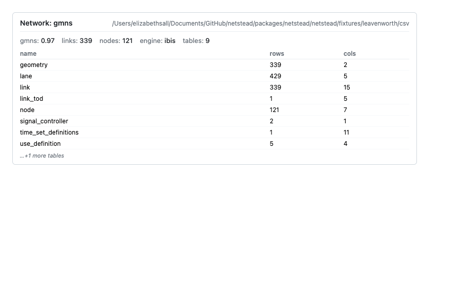
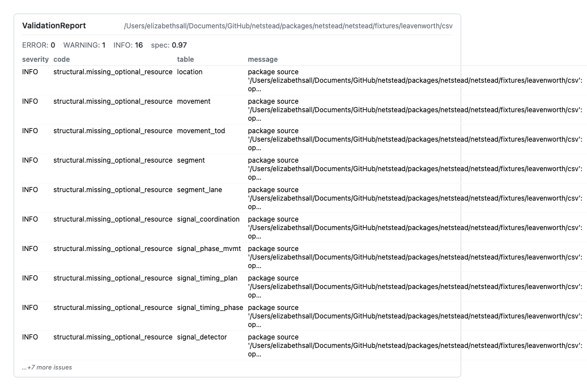
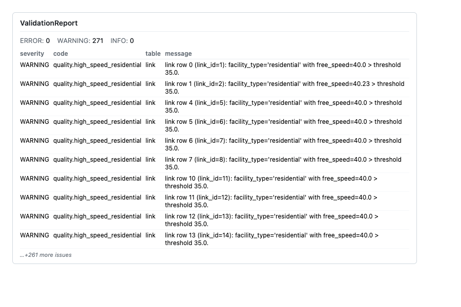
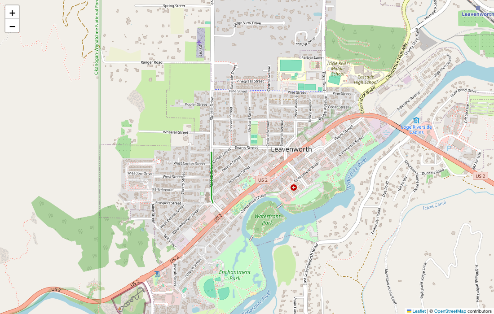

# Quickstart: Python

Prefer a browser? → [Quickstart: the Workbench](quickstart-workbench.md) does the same work with no code.

## When to use this

You're new to `netstead` and want to see what it does on a real GMNS network before reading anything else. Time budget: five minutes.

## Quick example

The fastest way to confirm `netstead` is wired up correctly is to install it, load the bundled Leavenworth, WA fixture, and print a one-line summary. `netstead` 1.0.0b2 is not on PyPI yet, so the beta installs from GitHub (both packages in one command; see [Install and troubleshoot](install.md)):

```bash
pip install \
  "dbcorral @ git+https://github.com/e-lo/netstead.git@main#subdirectory=packages/corral" \
  "netstead[clean,graph] @ git+https://github.com/e-lo/netstead.git@main#subdirectory=packages/netstead"
```

Then in Python:

```python
from netstead import Network
from netstead.fixtures import leavenworth

net = Network.from_source(leavenworth.csv_dir())
print(f"{net.spec_version}: {net.links.count()} links, {net.nodes.count()} nodes")
```

Expected:

```text
0.97: 339 links, 121 nodes
```

You just loaded the bundled Leavenworth network through the default ibis + DuckDB engine. Nothing was materialised — `net.links` is a lazy expression; only the integer count came back from DuckDB to Python.

## Step-by-step

### 1. Install

The bare `netstead` install is enough for read-only validation. Add `[clean,graph]` to unlock the ops the rest of this guide uses: `[clean]` brings in `shapely` + `geopandas` + `pyproj` for the geometry edits; `[graph]` brings in `scipy` (+ `numpy` + `pandas`) for the scope graph, connected components, and the data-quality rule pack.

```bash
uv init --bare
uv add \
  "dbcorral @ git+https://github.com/e-lo/netstead.git@main#subdirectory=packages/corral" \
  "netstead[clean,graph] @ git+https://github.com/e-lo/netstead.git@main#subdirectory=packages/netstead"
```

`uv init --bare` makes a new folder a uv project, which `uv add` needs; skip it when you add netstead to a project you already have.

This is the GitHub form the beta uses until the PyPI release is out; it then becomes `uv add 'netstead[clean,graph]'`, with `corral` coming along as a transitive dependency. For the other install tools (uv pip, pip, pipx), the full list of extras and what each pulls in, `netstead doctor`, and the zsh bracket-quoting rule, see [Install and troubleshoot](install.md).

### 2. Load the bundled fixture

The fixture is a small real network (Leavenworth, WA — an OSM-derived street grid roughly 2 km across) bundled inside the `netstead` wheel, so the example below runs without any download. `Network.from_source` accepts the same surface as `corral.Package.from_source`: local paths, URLs (`s3://`, `https://`, `duckdb://`), or directories of CSV / Parquet / DuckDB / zip-CSV.

```python
from netstead import Network
from netstead.fixtures import leavenworth

net = Network.from_source(leavenworth.csv_dir())
```

The result is a lazy `Network` object — its tables haven't been read yet. Print a quick summary to confirm it loaded:

```python
print(f"{net.spec_version}: {net.links.count()} links, {net.nodes.count()} nodes")
```

Expected:

```text
0.97: 339 links, 121 nodes
```

In a Jupyter notebook, evaluating `net` on its own renders an HTML summary card with the spec version, per-table row counts, and a preview of the first rows.

{ .screenshot }
*Network summary card (net._repr_html_() in a notebook) — spec version, table inventory with row counts, first-rows preview*

### 3. Validate against the spec

Validation runs four passes in a single call: **structural** (required tables and files), **schema** (per-field types and constraints), **foreign-key** (cross-table integrity), and **sync-state** (have any FKs gone stale since a previous edit?). The Leavenworth fixture has no ERRORs, but it is not spotless: expect 16 INFO findings (`structural.missing_optional_resource`, one per optional GMNS table the fixture doesn't ship) and 1 WARNING (`fk.unverifiable`: `node.zone_id` can't be checked because there is no `zone` table). That WARNING is why `report.is_clean` is `False` — `is_clean` means no ERRORs *and* no WARNINGs.

```python
report = net.validate()
print(f"issues: {len(report.issues)} ({report.spec_version})")
```

In a notebook, `report` on its own renders an HTML card grouped by severity.

{ .screenshot }
*Validation report card (report._repr_html_() in a notebook) — 0 ERRORs, 1 WARNING fk.unverifiable, 16 INFO structural.missing_optional_resource*

### 4. Run data-quality checks

The data-quality rule pack covers things the spec is silent on but every real network gets wrong sooner or later. Its nine rules cover high-speed-residential, lane-count mismatch, sharp-angle bends, near-duplicate nodes, disconnected components, implausible v/c ratios, missing critical fields, overlapping links and non-unique combinations (see [Customise the quality pack](cookbook/customise-quality.md)). Findings come back as WARNING or INFO by default and carry `category=DATA_QUALITY`. The rule pack needs the `[graph]` extra. On Leavenworth, `quality.high_speed_residential` fires on 271 residential links whose `free_speed` is 40 — above the default 35 mph threshold.

```python
from corral.quality import run_quality

qreport = run_quality(net)
for issue in qreport.issues[:5]:
    print(f"  {issue.severity.value:9} {issue.code:35} {issue.message[:60]}")
```

{ .screenshot }
*Quality report card (qreport._repr_html_() in a notebook) — 271 WARNING quality.high_speed_residential findings on residential links with free_speed=40 at the default 35 mph threshold*

### 5. Scope to a subgraph

The scope module lets you carve a smaller network out of a larger one without writing FK-pushdown SQL by hand. `from_node` builds a network-distance-bounded subgraph around a seed node; every related table (`lane`, `link_tod`, `movement`, signal control) is pre-filtered so the result is still a self-consistent GMNS network.

<!-- doctest: skip -->
```python
from netstead.scope import from_node

scoped = from_node(net, 1, network_buffer="200m").apply()
print(f"scoped: {scoped.links.count()} links, {scoped.nodes.count()} nodes")
```

That's a 200-metre Dijkstra-bounded buffer around node 1. Expected:

```text
scoped: 8 links, 5 nodes
```

{ .screenshot }
*Scoped subgraph (200 m network buffer around node 1, green) over the full Leavenworth network (grey context)*

### 6. Or run the same thing from the CLI

The CLI mirrors the Python API one-for-one. The same fixture lives at `packages/netstead/netstead/fixtures/leavenworth/csv` in the repo, so you can point the CLI at it directly.

```bash
netstead info packages/netstead/netstead/fixtures/leavenworth/csv
netstead validate packages/netstead/netstead/fixtures/leavenworth/csv
netstead quality packages/netstead/netstead/fixtures/leavenworth/csv
netstead scope from-node packages/netstead/netstead/fixtures/leavenworth/csv 1 --network-buffer 200m
```

`quality` and `scope` need the `[graph]` extra; `info` and `validate` run on the bare install.

By default `netstead` prints colorized tables and panels for humans. Add `--json` and you get a single machine-readable JSON document on stdout instead — useful for scripting, CI checks, or feeding the output to an AI agent.

```bash
netstead validate --json packages/netstead/netstead/fixtures/leavenworth/csv | jq '.issues | length'
```

## Common variations

Each accordion below is one alternative to the defaults used above. The first (most common) is expanded; the rest are collapsed — open the one that matches your situation.

???+ note "Pick a different GMNS spec version"
    The vendored versions are 0.95, 0.96, and 0.97; default is 0.97. Networks load against the version they were written against — no silent upgrades.

    ```python
    net = Network.from_source(leavenworth.csv_dir(), spec_version="0.96")
    ```

??? note "Get a pandas (or polars) frame"
    DuckDB (via ibis) is the only compute engine, and every table stays lazy until you ask. When downstream code wants a DataFrame, materialise just that table with `.to_pandas()` or `.to_polars()`.

    ```python
    links_df = net.links.to_pandas()
    ```

??? note "Read from S3 with credentials"
    Credentials resolve via a cascade: keyword arg → `CORRAL_CRED_<host>_TOKEN` env var → OS keyring → `.netrc`. No code changes if your environment is already set up.
<!-- doctest: skip -->

    ```python
    net = Network.from_source("s3://bucket/network/")
    ```

??? note "Write the scoped network out"
    The output format follows the destination: an extension-less path or `.parquet` writes a directory of GeoParquet files (one per table); `.csv` writes a CSV directory; `.duckdb` writes a single DuckDB file; `.zip` writes zipped CSV.
<!-- doctest: skip -->

    ```python
    scoped.write("./scoped.parquet")
    ```

??? note "Run the data-quality pack with custom thresholds"
    Per-rule config keys override defaults. The example below tightens the residential-speed threshold to 30 mph.

    ```python
    from corral.quality import RuleConfig, run_quality

    qreport = run_quality(
        net,
        config={
            "quality.high_speed_residential": RuleConfig(
                thresholds={"speed_limit_mph": 30.0}
            )
        },
    )
    ```

## Pitfalls

* **Auto-build of the graph index on large networks.** The first `from_node` or `connected_component` call on a network larger than 50k nodes builds the scipy `GMNSGraph` adjacency on the spot and logs an INFO notice. Pre-build with `net.build_indexes(graph=True)` if you want to control the timing, or set `NETSTEAD_AUTO_INDEX_THRESHOLD` to raise the auto-build bar.
* **Duplicate-near-nodes default threshold is tight** (`epsilon_units=1e-5`). Networks in WGS84 degrees barely trigger it; networks in projected meters need an explicit threshold via `RuleConfig`.
* **Editing requires a `Session`.** Don't mutate tables directly — open `with corral.editing.Session(net) as s:` and pass `s` into the `netstead.clean.*` ops. See [Edit a network with atomic rollback](cookbook/edit-with-rollback.md).

## See also

* [Cookbook](cookbook/index.md) — task-oriented recipes for the common workflows.
* [Python tour (notebook)](python-tour.md) — see every step above rendered as maps, cards, and diffs in a notebook.
* [Visual tour](visual-tour.md) — the same network in the browser Workbench, screen by screen.
* [API reference](reference/api.md) — every symbol you saw above.
* [Architecture](https://e-lo.github.io/netstead/corral/architecture/) — design rationale for the defaults.
